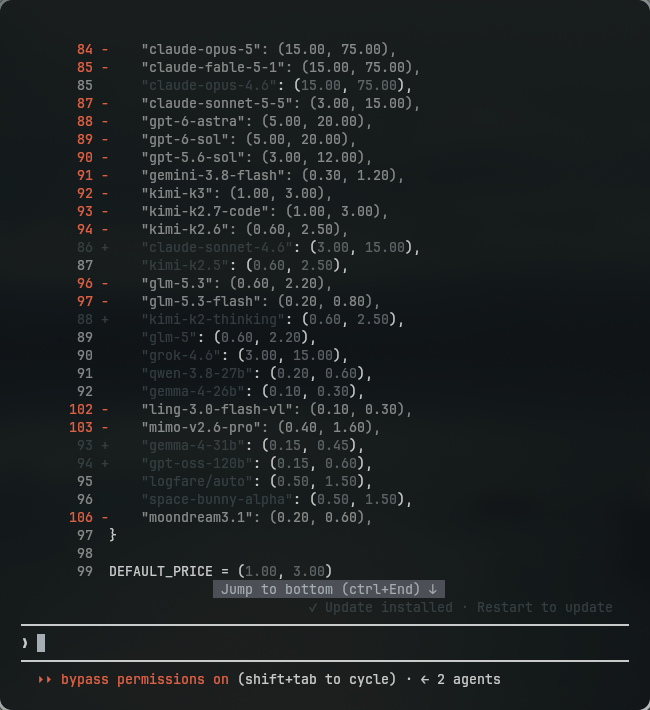
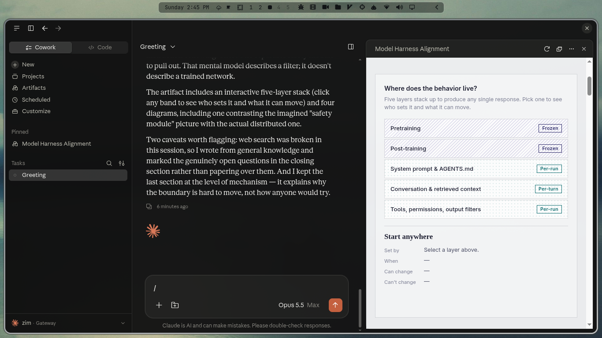
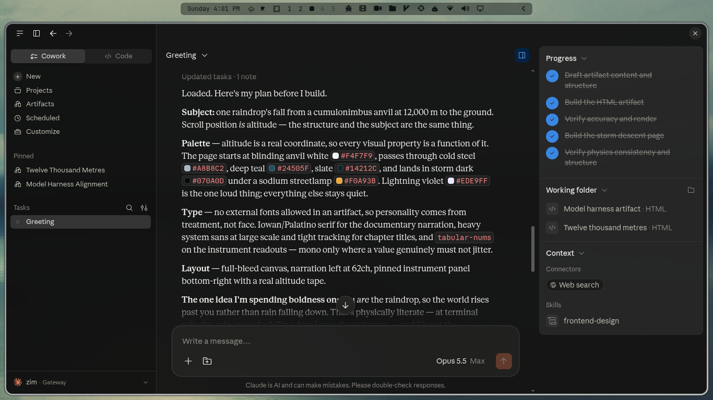
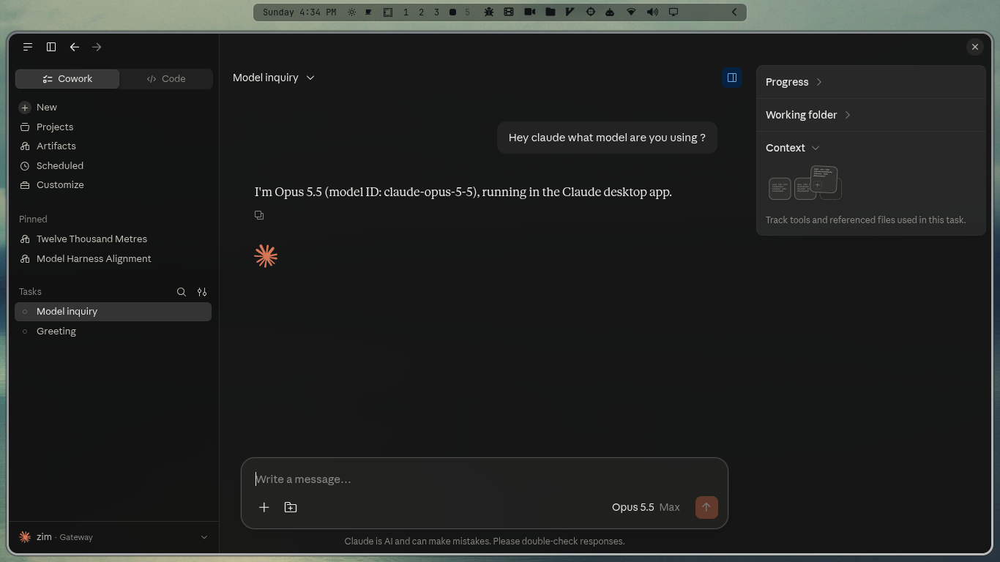

<div align="center">

<h1>zim-claude</h1>

<p><strong>Claude Code, pointed at Numes.</strong></p>

<p>Same flags, same subcommands, same interactive UI as <code>claude</code> —<br>
it just talks to Numes instead of Anthropic.</p>

<p>
<a href="#install"></a>
<a href="#numes"></a>
<a href="#numes"></a>
<a href="https://numes.ai/dashboard/keys"></a>
</p>



</div>

---

## What it is

A drop-in replacement for `claude`. Every flag and subcommand passes through untouched:

```bash
zim-claude                                  # interactive session
zim-claude --dangerously-skip-permissions   # any claude flag works
zim-claude -p "explain this function"       # non-interactive
zim-claude mcp list                         # any claude subcommand works
zim-claude mcp add demo -- npx -y some-mcp  # arguments pass through untouched
```

The one wrinkle is the protocol. **Numes speaks the OpenAI Chat Completions API;
Claude Code speaks only the Anthropic Messages API.** Numes deliberately has no
`/v1/messages` route, so pointing `ANTHROPIC_BASE_URL` at Numes gives a 404 on every
turn. `zim-claude` therefore starts a small local translation proxy for the session,
points one `claude` process at it, and stops it when the session ends:

```
  Claude Code  ──Anthropic Messages──▶  zim-claude-numes-proxy  ──Chat Completions──▶  Numes  ──▶  the model you picked
   zim-claude                           (127.0.0.1, per session)                        (one key)
```

There is no system-wide daemon, no config file and no shell-profile mutation. The
proxy is a child of the wrapper, listens on loopback only, and is killed when `claude`
exits. A plain `claude` in another terminal is untouched.

## Numes

[Numes](https://numes.ai) is a marketplace for AI inference: independent providers
serve the models, and you call all of them through one OpenAI-compatible endpoint with
one key. Pricing is per token and charged against a prepaid balance in the key's chosen
currency (USD or BTC).

Not every model is paid. The catalogue currently lists **six genuinely free,
tool-capable models** — `$0` input and `$0` output:

| Model id | Name | Context |
|---|---|---|
| `deepseek/deepseek-v4.1-flash` | DeepSeek V4.1 Flash | 1M |
| `moonshotai/kimi-k3.1-pro` | Kimi K3.1 Pro | 1M |
| `nvidia/nemotron-3-ultra-550b-a55b` | Nemotron 3 Ultra | 200k |
| `dealignai/deepseek-v4.1-flash-uncensored-fp8` | DeepSeek V4.1 Flash Uncensored FP8 | 1M |
| `dealignai/glm-5.3-flash-uncensored-fp8` | GLM 5.3 Flash Uncensored FP8 | 1M |
| `dealignai/glm-5.3-uncensored-fp8` | GLM 5.3 Uncensored FP8 | 1M |

The model picker prints each model's price beside its name and lists free models first,
so the distinction is visible rather than implied. It defaults to the free DeepSeek
V4.1 Flash. `ZIM_CLAUDE_FREE_ONLY=1` narrows the list to those $0 models.

"Free" here means a `$0` token price, not an unlimited account: paid models draw down
the key's balance, and the picker prints the remaining budget from `GET /key` above the
list. If the balance is exhausted, paid models fail with a 402 while free models keep
working.

### Get a Numes key

1. Create one at [numes.ai/dashboard/keys](https://numes.ai/dashboard/keys). Pick its
   currency (USD or BTC) — it cannot be changed later.
2. Either paste it at the first prompt — it is cached at
   `~/.local/share/zim-claude/numes.key` (mode 600) — or export `NUMES_API_KEY=sk-…`
   and keep it in your shell profile.
3. Pin a model with `ZIM_CLAUDE_MODEL=deepseek/deepseek-v4.1-flash` to skip the picker.

The key is asked for **once**. After that every run reads the cached copy. A key from
the environment is never written to disk.

### What a run actually does

Seven steps, in order. Each one exists because of a specific thing Numes does
differently from Anthropic, and each is worth knowing when something goes wrong.

**1. The API root is `https://api.numes.ai/api/v1`.**

Chat lives at `/chat/completions`; key metadata at `/key`; the catalogue at `/models`.
There is no Anthropic Messages route. That is why the wrapper starts the translation
proxy rather than exporting the upstream URL directly.

**2. The key is validated against `/key`, not `/models`.**

`/key` is the credential probe: it answers `401` for a bad key and `200` for a good one,
and it carries the key's limit, remaining balance and usage. The catalogue is a second
request because it is a different thing — `/key` carries the budget, `/models` carries
the lineup. (`/credits` exists too, but it requires a *management* key, not an inference
key.)

**3. The catalogue is filtered to models that can drive Claude Code.**

The wrapper fetches
`/models?output_modalities=text&supported_parameters=tools&sort=pricing-low-to-high`.
Claude Code is entirely tool-driven: a model without tool calling can answer prose but
cannot read files, run commands or edit code. Filtering on `tools` keeps unusable rows
out of the picker; sorting by price puts the free models at the top. If a key can see no
tool-capable model, the wrapper retries unfiltered and warns.

**4. A model is chosen, and the choice is remembered.**

The picker shows the model id, display name, price and context length, and defaults to
last session's model when the catalogue still lists it. A fresh install starts on
`deepseek/deepseek-v4.1-flash`. `ZIM_CLAUDE_MODEL` skips the picker entirely, which is
what a script wants.

**5. A session settings file puts every model in `/model`.**

Claude Code's built-in `/model` list knows nothing about Numes' ids. The wrapper writes
a `modelPicker` file and passes it with `--settings`, so `/model` lists **every model in
the catalogue** under its real name, for that session only.

**6. The local proxy starts on a free loopback port.**

It is
[`scripts/zim-claude-numes-proxy`](scripts/zim-claude-numes-proxy), a stdlib-only Python
program. It translates system prompts, user/assistant turns, images, `tool_use` /
`tool_result` blocks, tool schemas, `tool_choice`, `max_tokens`, sampling parameters and
streaming SSE. Tool calls are native: Numes supports them, so there is no prompt-emulated
tool protocol to drift. The wrapper reads the port from a private file, health-checks it,
and passes `--parent-pid` so the proxy exits if the wrapper is killed.

**7. `claude` runs with `ANTHROPIC_*` scoped to that process, then the proxy stops.**

Nothing is written to your shell profile, and nothing is exported globally. When
`claude` exits its status is passed through unchanged, the proxy is stopped and the
port file is removed.

### Switching models with `/model`

`/model` inside Claude Code lists Claude Code's built-in lineup, which knows nothing
about Numes' ids. `zim-claude` fixes that by writing a `modelPicker` settings file and
passing it with `--settings`, so `/model` lists every Numes model under its real name:

```
/model
  → DeepSeek V4.1 Flash, Kimi K3.1 Pro, GPT-6 Luna, Claude Opus 5.5,
    Gemini 4 Argon, Mistral Nemo, …
```

Four details worth knowing:

* **Nothing is written to `~/.claude/settings.json`.** These models only exist while
  routed through Numes, so a plain `claude` in another terminal must not inherit them.
  The file lives at `~/.local/share/zim-claude/claude-settings.json`.
* **Your own `--settings` wins.** If you pass one, the wrapper steps aside and says so.
* **`ZIM_CLAUDE_NO_PICKER=1`** turns the whole thing off — including on a machine that
  has already run once and left a settings file behind.
* **The proxy honours the id.** A `/model` pick containing `/` (every Numes id) is sent
  upstream as-is. Anthropic tier names Claude Code invents for background calls are
  mapped to the session's model, because Numes has no such ids.

Claude Code's own gateway discovery (`CLAUDE_CODE_ENABLE_GATEWAY_MODEL_DISCOVERY=1`) is
*not* used, deliberately: it keeps only ids containing `claude` or `anthropic`, which
would hide every non-Claude model — most of the catalogue.

### The context window, and why it needs two settings

This is the least obvious part of the integration, and getting it wrong is silent until
a long session dies.

Claude Code ships a catalog of the models it knows. Every Numes id — including
`anthropic/claude-opus-5.5`, which is not the id Claude Code knows — is **not in that
catalog**. For an unknown model Claude Code does not refuse to run; it guesses, and its
guess is a **1M-token window**. Several Numes models are **128k** or **200k**. That
guess is too generous, and the consequence is not cosmetic: auto-compact waits for 1M
tokens of history before it fires, so the request hits the model's real limit and
**400s on length long before compaction ever runs**. The session dies instead of
compacting.

On top of that, every run printed a warning:

```
Claude Code doesn't recognize the model "deepseek/deepseek-v4.1-flash", so it assumes a
context window of 1m tokens.
```

Two separate settings fix the two separate halves of this, and **neither one alone is
enough**:

| Setting | What it fixes | What it does not |
|---|---|---|
| `behavesAs` on the `modelPicker` row | the warning, and the client-side handling (prompt profile, capability and effort defaults) | the window — it inherits the borrowed model's 200k |
| `CLAUDE_CODE_AUTO_COMPACT_WINDOW` | the window Claude Code actually plans against | the warning |

So the wrapper does both. Every row gets `"behavesAs": "claude-sonnet-4-5"` — a stable
id, and the closest match for a general tool-calling model — and
`CLAUDE_CODE_AUTO_COMPACT_WINDOW` is set to the **catalog's own `context_length`** for
the model you picked, not to a number hardcoded in the wrapper. If Numes changes a
model's window, the wrapper follows it on the next run.

Claude Code caps the value it accepts at 1,000,000 and warns above it, so the wrapper
clamps a larger catalogue figure (some Numes models advertise 1,048,576) to 1M. Only
the last 48k of those models goes unused, and the session stays quiet.

`CLAUDE_CODE_MAX_CONTEXT_TOKENS` is *not* the lever here, though it looks like one. It
silences the prose but leaves the 1M assumption in place and still emits the
`[claude-code:unrecognized_model]` telemetry line.

The result is a session that is quiet and correctly bounded:

```
$ zim-claude -p "/context"
## Context Usage
**Model:** deepseek/deepseek-v4.1-flash
**Tokens:** 20.5k / 1M (2%)
```

### The default model

A fresh install starts on **DeepSeek V4.1 Flash** (`deepseek/deepseek-v4.1-flash`) — a
free, tool-capable 1M-context entry. It is a speed and cost choice: the model is `$0` in
and `$0` out. For heavier agentic work, `/model` to `anthropic/claude-sonnet-5.5` or
`anthropic/claude-opus-5.5`, which draw on the account balance.

### Keys from other providers are refused

A key from a provider this package no longer routes to cannot work, and sending it to
Numes would read as "your key is broken". The wrapper names the real reason instead:

| Situation | What happens |
|---|---|
| `ZIM_CLAUDE_API_KEY` holds a `coa_…` key | refused — Coarena is no longer a route |
| `ZIM_CLAUDE_API_KEY` holds a `tj_…` key | refused — Token Juice is not a route |
| `ZIM_CLAUDE_API_KEY` holds a `thk_…` key | refused — TokenHarbor is not a route |
| `ZIM_CLAUDE_BASE_URL` names any of them | refused, with the reason |
| No key anywhere, terminal available | prompts once, then caches it |
| No key anywhere, no terminal | exits 2 and names `NUMES_API_KEY` |

The old shared Token Juice key still sits in `config/token`, kept as a marker so nobody
goes looking for it — but **nothing loads it any more**: not the installer, not the
wrapper, not the Windows port. `tests/run-tests.sh` fails if a loader comes back.

### The LiteLLM proxy is optional and unrelated

`install.sh` still installs the LiteLLM proxy and its `~/tokenjuice/` config, because
other harnesses on the machine may use it. `zim-claude` itself does not touch it: the
Numes route goes through the bundled Python proxy, and the wrapper never reads
`~/tokenjuice/`.

---

## Install

<table>
<tr><th align="left">Linux · macOS · WSL</th><th align="right">Windows</th></tr>
<tr><td>

<pre><code>git clone &lt;this repo&gt; zim-claude
cd zim-claude
./install.sh</code></pre>

</td><td>

<pre><code>git clone &lt;this repo&gt; zim-claude
cd zim-claude\windows
win-install.bat</code></pre>

</td></tr>
</table>

That's it. Open a new terminal and run `zim-claude`.

The installer does not ask for a Numes key — it installs the command and the translation
proxy, records the checkout for auto-update, and leaves `~/tokenjuice/` exactly as it
found it. Run `zim-claude` and it asks for a key once, then caches it (see
[Numes](#numes)).

If you want the optional LiteLLM proxy route for another harness on the machine, pass a
key in:

```bash
ZIM_CLAUDE_TOKEN=tj_… ./install.sh
```

### Which installer do I run?

| Installer | Platform | What it sets up | Run it with |
|---|---|---|---|
| `install.sh` | Linux · macOS · WSL | the `zim-claude` command (Numes) + the optional CLI proxy | `./install.sh` |
| `windows\win-install.bat` | Windows | `zim-claude` (Numes), plus the optional CLI proxy *and* the `:4002` desktop gateway | `win-install.bat` |
| `claude-desktop-integration/install.sh` | Linux · macOS | the `:4002` gateway only (Token Juice, not Numes) | `cd claude-desktop-integration && ./install.sh` |

You normally only need the first one for your platform. The third exists for people who
want the Claude Desktop gateway without the CLI side.

> **On Windows, `win-install.bat` is the entry point** — it forwards every flag to
> `win-install.ps1`, which holds the logic. It is a `.bat` so it can be double-clicked
> and so it still runs when the machine's execution policy would refuse a bare `.ps1`.

---

## Requirements

`zim-claude` needs `claude`, `bash`, `curl`, `base64` and **Python 3.8+**. The optional
LiteLLM proxy needs `litellm` on top. The installer checks for each and offers to install
anything missing. **Nothing is installed without you answering `y`.**

| Tool | If missing |
|---|---|
| `bash`, `curl`, `base64` | required — the installer reports and exits |
| `python3` 3.8+ | required for the Numes translation proxy — the installer reports the platform's install command |
| Claude Code (`claude`) | offers `curl -fsSL https://claude.ai/install.sh \| bash` |
| `litellm` | offers to build a private virtualenv containing it |

**Python is part of the Numes route, not an optional extra.** Claude Code itself does
not need Python; the translation proxy does. On a machine without Python the CLI cannot
complete a turn, so the installer treats a missing `python3` as a failed prerequisite
rather than a note. Windows requires Python 3.10+ (the installer offers
`winget install Python.Python.3.12`).

**You do not need litellm, pip, or a writable system Python.** If no `litellm` is
found, the installer creates a virtualenv at `~/.local/share/zim-claude/venv` and
installs `litellm[proxy]` and `uvloop` into it. Nothing is activated by hand and no
`--break-system-packages` is involved. If you already have a `litellm` on `PATH` or in
`~/.local/bin`, it is reused and no venv is built.

Claude Code uses Anthropic's official installer rather than `npm install -g`: no Node
dependency, and it sets up the launcher and shell integration itself. It is run
**without sudo** — it installs under `$HOME` and exits with an explicit error if it
detects sudo, so running it under sudo would guarantee failure.

<details>
<summary><b>If <code>python3</code> has no <code>pip</code> or no <code>venv</code></b></summary>

Neither is needed for the Numes proxy: it is stdlib-only, so the interpreter alone is
enough. The LiteLLM proxy still needs a venv, and `python3 -m venv` bootstraps its own
`pip` from `ensurepip`, so a Python with no system pip still builds it — this is the
default on Arch, where `python` ships without pip. The old advice here
(`python3 -m pip install ...`) failed with `No module named pip` and installed nothing;
the venv path avoids that entirely.

`venv` itself is the one thing that must be present for the LiteLLM proxy. Debian/Ubuntu
split it out of the interpreter package, and the installer detects that and names the
fix:

| Platform | If `python3 -m venv` is missing |
|---|---|
| Debian/Ubuntu | `sudo apt install python3-venv` |

`pipx install 'litellm[proxy]'` also works if you prefer it — `start-litellm.sh` uses
whatever litellm it finds first, so a pipx install is picked up and no venv is built.

</details>

<details>
<summary><b><code>zim-claude: command not found</code> right after installing</b></summary>

The installer is a subprocess and cannot change the `PATH` of the shell that launched it.
A new terminal picks up `~/.local/bin` automatically; to fix the shell you are already in:

```bash
export PATH="$HOME/.local/bin:$PATH"
```

(`hash -r` will not help — it clears bash's command-lookup cache and never adds a
directory to `PATH`.)

</details>

### What it puts where

| Path | Purpose |
|---|---|
| `~/.local/bin/zim-claude` | the command |
| `~/.local/bin/zim-claude-numes-proxy` | the per-session Anthropic ↔ OpenAI translation proxy |
| `~/.local/bin/zim-claude-update.sh` | background self-updater (also runnable by hand) |
| `~/.local/bin/start-litellm.sh` | optional proxy manager: `start`/`stop`/`restart`/`status`/`logs` |
| `~/tokenjuice/source` | the optional LiteLLM proxy's env profile — Token Juice key + base URL + model (mode 600); only written when you pass `ZIM_CLAUDE_TOKEN` |
| `~/tokenjuice/litellm-config.yaml` | LiteLLM proxy config: which model name maps to which upstream |
| `~/.local/share/zim-claude/venv/` | the optional proxy's private virtualenv (litellm + uvloop) |
| `~/.local/share/zim-claude/numes.key` | your Numes key, cached after the first prompt (mode 600) |
| `~/.local/share/zim-claude/claude-settings.json` | the `modelPicker` file that puts the whole catalogue in `/model` (mode 600) |
| `~/.local/share/zim-claude/last-model` | the model you picked last time — the picker's default |
| `~/.local/share/zim-claude/numes-proxy.log` | what the translation proxy said (rotated at 256 KB) |
| `~/.local/share/zim-claude/update.conf` | which checkout and branch the updater tracks |
| `~/.local/share/zim-claude/update.log` | what the updater did, last few hundred KB |
| `~/.local/share/zim-claude/` | install state + backups (mode 700) |

Anything it would overwrite is backed up first, under
`~/.local/share/zim-claude/backups/<timestamp>/`.

### Where the optional proxy configuration lives

Both the credential and the model names for the **optional LiteLLM route** live in one
directory outside the repo — `~/tokenjuice/`, which other harnesses on the machine
share. **`zim-claude` does not read any of it**: it is kept for the other harnesses and
for a Token Juice key of your own.

| File | What is in it | Who owns it |
|---|---|---|
| `~/tokenjuice/source` | `ANTHROPIC_AUTH_TOKEN` (the `tj_…` key), `ANTHROPIC_BASE_URL`, `ANTHROPIC_MODEL` — mode 600 | you; `install.sh` creates it only when it is missing |
| `~/tokenjuice/litellm-config.yaml` | the CLI route: model alias → Token Juice upstream id | you; `install.sh` copies the template in only when it is missing |
| `~/tokenjuice/litellm-config.desktop.yaml` | the `:4002` route for Claude Desktop, under a `claude-*` alias | you; `claude-desktop-integration/install.sh` copies it in only when it is missing |

Change the model by editing the `model_name` in `litellm-config.yaml` and the
`ANTHROPIC_MODEL` in `source`, then `start-litellm.sh restart`. The upstream id in
Token Juice carries a rotating snapshot suffix, so re-read
`https://api.tokenjuice.ai/v1/models` before picking a new one — a stale suffix fails as a
bare `404 Model not found`.

Nothing in this repo overwrites those three files, `--force` included. `config/` and
`claude-desktop-integration/` hold the templates used for a first install, and
`ZIM_CLAUDE_TOKENJUICE_DIR` moves the whole directory if you want it somewhere else.

### Installer flags

```
./install.sh                install
./install.sh --dry-run      print every action, change nothing
./install.sh --uninstall    remove what the installer created
./install.sh --force        overwrite files you have hand-edited (still backs up)
./install.sh --no-rc        don't touch ~/.bashrc
./install.sh --start        start the LiteLLM proxy when done
./install.sh --no-venv      never build the proxy virtualenv
./install.sh --port N       use port N instead of auto-detecting one
```

Re-running `install.sh` is safe and idempotent — it compares file contents and skips
anything already up to date, and a venv that already holds litellm is left alone.

Building the venv downloads a few hundred megabytes, so it is **asked about, never
assumed**. In a non-interactive run (`curl … | bash`, CI) there is no terminal to ask, so
it is skipped and the installer says so — the CLI half still installs. Re-run
`./install.sh` from a terminal to build it, or use `--no-venv` to skip the question.

`--uninstall` removes the files it installed, but **only if you haven't edited them**,
and never touches `~/tokenjuice/` — neither the profile nor the model config. It removes
the proxy virtualenv too — but only one this installer built; a venv you made yourself
is left in place. Your cached Numes key and `/model` settings are yours and stay put.

**The credential never comes from the repo.** `~/tokenjuice/` is shared with other
harnesses on the machine, so an existing profile and an existing model config are used
as they are and never rewritten, `--force` included. If the profile already holds a key,
it is kept — with a warning when it does not look like a Token Juice key (`tj_…`),
because Token Juice will reject a key issued elsewhere. If there is no profile at all,
the installer uses `ZIM_CLAUDE_TOKEN` when it is set and otherwise skips the profile
entirely — a missing key is not an error, and nothing is read from `config/token`.

It also repairs a profile that points at a port which **rejects its own token**. That
happens when another LiteLLM — ZimZilla's, a leftover install — already owns the port
and answers every request with `No connected db.` The token is fine, the port is not, so
the installer backs the profile up and moves only `ANTHROPIC_BASE_URL`.

### Which port it picks

The installer probes the local ports and writes the one that works into the profile:

| Found | Result |
|---|---|
| The profile's port already accepts the token | keep it |
| The profile's port is free | keep it — the optional proxy can start there |
| The profile's port is held by a proxy that rejects the token | move to a port that accepts it |
| No proxy accepts the token anywhere | take the first free port |

The default is `4000`. Candidates are tried in the order `4000`, `4001`, then `4003`–`4010`
(`4002` is the Claude Desktop gateway). Override the whole search with `--port N`.

The proxy manager follows the profile's port, so a profile moved to `:4005` works with no
environment variable set. `LITELLM_PORT` still wins when you set it explicitly.

### The shell config

An `ANTHROPIC_AUTH_TOKEN` in `~/.bashrc` that points at the local LiteLLM proxy but is
not the profile's key is a dead provider for plain `claude`. The installer backs the file
up and rewrites those four `ANTHROPIC_*` lines to the profile's key, the auto-detected
port, and the model named in `~/tokenjuice/litellm-config.yaml`. Everything else in the
file — your aliases, your own exports, the `PATH` block — is untouched.

A profile aimed at another provider is reported, never changed. `--no-rc` skips this
migration along with the `PATH` block.

### Auto-update

`zim-claude` keeps itself current. Each time it starts, it launches
`zim-claude-update.sh` **in the background** and then hands off to `claude` immediately —
the updater can never delay, block or fail a session. It costs a fork, and the health
check is unaffected.

The updater is deliberately conservative:

| Rule | Why |
|---|---|
| At most once an hour | a fetch on every invocation would be noise |
| Locked | two sessions starting at once cannot update together |
| Clean checkout only | a dirty tree is reported and skipped, never stashed |
| Fast-forward only | never `reset`, `force` or merge; a diverged branch is left alone |
| `--no-venv --no-rc` | no surprise downloads, no rewriting your shell config |
| Never restarts the proxy | a running session keeps its proxy and config |

It only works from a git checkout on a named branch — an unpacked tarball has nothing to
pull from, and the installer records `auto-update: disabled` in that case. Point it at a
different checkout by re-running `./install.sh` from that checkout.

```bash
zim-claude-update.sh          # update now, ignoring the interval
```

Configure or disable it with environment variables:

| Variable | Default | Meaning |
|---|---|---|
| `ZIM_CLAUDE_NO_UPDATE` | `0` | set to `1` to never auto-update |
| `ZIM_CLAUDE_UPDATE_INTERVAL` | `3600` | seconds between checks (`0` = every run) |
| `ZIM_CLAUDE_UPDATE_FORCE` | `0` | set to `1` to ignore the interval |
| `ZIM_CLAUDE_UPDATE_TIMEOUT` | `20` | seconds allowed for `git fetch` |

The log is at `~/.local/share/zim-claude/update.log` (rotated at 256 KB). Every outcome —
updated, already current, dirty, diverged, fetch failed — is a line there.

---

## Windows

Windows gets its own installer under `windows/`. It is **native** — no WSL, no Git Bash,
no Node, and no Administrator rights.

`zim-claude` routes to Numes here too. The same Python translation proxy is installed
beside the wrapper (`zim-claude-numes-proxy.py`), so **Python 3.10+ is required** for the
CLI. The optional LiteLLM proxies below are separate; one installer sets up **both** of
them because on Windows they are usually wanted together:

| | CLI (Numes) | Optional LiteLLM proxies |
|---|---|---|
| Route | `claude` → local Python proxy → `api.numes.ai` | `:4000` CLI, `:4002` Claude Desktop |
| Config | `%USERPROFILE%\.local\share\zim-claude\` | `%USERPROFILE%\tokenjuice\litellm-config*.yaml` |
| Credential | `%USERPROFILE%\.local\share\zim-claude\numes.key` | `%USERPROFILE%\tokenjuice\source` |
| Log | `...\numes-proxy.log` | `...\logs\cli.log`, `...\logs\desktop.log` |

It installs the same `zim-claude` command you get on Linux, into
`%USERPROFILE%\.local\bin`:

```bat
zim-claude                                  :: interactive session
zim-claude --dangerously-skip-permissions   :: any claude flag works
zim-claude -p "explain this function"       :: non-interactive
zim-claude mcp list                         :: any claude subcommand works
```

The command works identically from `cmd.exe` and from PowerShell. Every argument is
forwarded to `claude.exe` untouched, and its exit code passes through — so
`zim-claude -p "x" && next-step` behaves the way you'd expect.

### Windows flags

```
win-install.bat                 install both sides, start the optional proxies
win-install.bat -DryRun         print every action, change nothing
win-install.bat -SkipDesktop    CLI only
win-install.bat -SkipCli        Claude Desktop gateway (:4002) only
win-install.bat -NoStart        install but don't start the optional proxies
win-install.bat -Force          overwrite hand-edited files (backed up first)
win-install.bat -Port N         use port N instead of auto-detecting one
win-install.bat -Uninstall      remove what the installer created
```

Start with `-DryRun` to review every action before anything changes.

Same guarantees as the Linux installer: it backs up anything it would overwrite,
compares contents so a re-run is a no-op, and **never overwrites your env profile** —
that file holds a live credential, so `-Force` does not apply to it.

### Manage the optional proxies

`start-proxies` drives both:

```powershell
start-proxies start                 # bring both up
start-proxies status                # is it running?
start-proxies status -Which desktop # just the :4002 gateway
start-proxies gateway               # print the values for the Desktop UI
start-proxies logs                  # tail both logs
start-proxies restart
start-proxies stop
```

Run the command, not the `.ps1` by name. A `.ps1` cannot be executed by name alone
(`.\start-proxies.ps1` is required, and on a Windows client the default `Restricted`
execution policy blocks it anyway). `start-proxies.cmd` is what makes the plain
command work: it passes `-ExecutionPolicy Bypass` for that one invocation, so your
machine's policy is untouched. Every `.ps1` here has such a shim for the same reason.

You normally never need these: on Windows too, `zim-claude` itself talks to Numes and
never starts or health-checks these proxies. They are the optional LiteLLM route.

Windows gets the same auto-update as Linux: `zim-claude` starts
`zim-claude-update.ps1` in a hidden background process and hands off immediately. It
reads `%USERPROFILE%\.local\share\zim-claude\update.json`, writes its log to
`...\update.log`, and runs `win-install.bat -NoStart` after a fast-forward. Run
`zim-claude-update` (the `.cmd` shim) to update by hand, or set `ZIM_CLAUDE_NO_UPDATE=1`
to disable it.

### Windows requirements

| Tool | If missing |
|---|---|
| Python 3.10+ | required for the Numes translation proxy; offers `winget install Python.Python.3.12` |
| `litellm` | offers `python -m pip install --user "litellm[proxy]"` (optional route only) |
| Claude Code | offers Anthropic's native installer, `irm https://claude.ai/install.ps1 \| iex` |

Claude Code on Windows needs **no** WSL, Node, or Administrator rights. It installs to
`%USERPROFILE%\.local\bin\claude.exe`. [Git for Windows](https://git-scm.com/downloads/win)
is optional — Claude Code only needs it for its Bash tool.

`install.sh` at the repo root remains the Linux/macOS/WSL installer and is unchanged.

---

## Claude Desktop — the `zim` gateway

> **This is the optional Token Juice route, not the Numes CLI route.** It is separate
> from `zim-claude`: its own port, config, log and PID file. The CLI proxy below steers
> **Claude Code**; Claude Desktop is a different app and ignores those environment
> variables.

The **zim gateway** provides a free Claude Opus tier to Claude Desktop through LiteLLM.
When it spawns its embedded agent Claude Desktop *blanks* the `ANTHROPIC_*` variables and
injects its own credentials. It only accepts a custom endpoint through
**Third-Party Inference → Gateway**.

So there is a second, independent proxy on `:4002` for it. Separate port, config, log and
PID file — the CLI proxy keeps working untouched.

<div align="center">

<table>
<tr>
<td align="center" valign="top" width="50%">
<br>
<sub>The model picker reads a Claude-shaped name; the status bar reads <code>zim · Gateway</code>.</sub>
</td>
<td align="center" valign="top" width="50%">
<br>
<sub>Cowork sessions, progress tracking and the working-folder panel all work normally.</sub>
</td>
</tr>
</table>



<p><em>Asked which model it is, the session answers with the name the gateway exposes it
under.</em></p>

</div>

### Set it up

**Windows** — the installer sets up the proxy; you still paste the values into the app
once (Windows has no managed-config file, so there is nothing the installer can write
for you):

```bat
cd windows
win-install.bat
```

Use `-SkipCli` if you want only the `:4002` gateway. The desktop config lands at
`%USERPROFILE%\.local\share\zim-claude\desktop\litellm-config.desktop.yaml`, its log at
`...\logs\desktop.log`. `start-proxies.ps1 gateway` prints the exact values for the
dialog, and `windows\verify.ps1` proves the gateway answers.

> **Use the key `start-proxies.ps1 gateway` prints, not the one in this README.** If
> `CLAUDE_DESKTOP_LITELLM_KEY` is set, the proxy enforces *that* key. A mismatch comes
> back as `{"error":{"message":"No connected db.","type":"no_db_connection"}}` — LiteLLM
> treats an unmatched key as a DB-backed virtual key and there is no DB.

**Linux · macOS** — run the desktop installer:

```bash
cd claude-desktop-integration
./install.sh
```

It starts the proxy and prints the exact values to paste into the app. It does **not**
touch the CLI proxy or your shell config.

Then, in Claude Desktop:

1. **Help → Troubleshooting → Enable Developer Mode**
2. **Claude menu → Developer → Configure Third-Party Inference…**
3. Connection section:

   | Field | Value |
   |---|---|
   | Inference provider | `Gateway` |
   | Gateway base URL | `http://127.0.0.1:4002` |
   | Gateway API key | `sk-claude-desktop-local` |
   | Gateway auth scheme | `bearer` |

4. **Apply Changes** (older builds: *Apply locally*), then **restart Claude Desktop**.

The picker now lists `claude-opus-5-5`, and every Cowork, Chat and Code model call goes
through LiteLLM.

<details>
<summary><b>No-click alternative (managed config, Linux only)</b></summary>

```bash
./install.sh --managed          # needs sudo -> /etc/claude-desktop/managed-settings.json
./install.sh --uninstall-managed
```

This is the same content as `managed-settings.json`. A managed profile may make the app
show a *managed configuration* notice — that is expected.

**`--managed` has no Windows equivalent here** — it writes to `/etc/` with sudo. On
Windows, use the in-app dialog above.

</details>

### Desktop gateway configuration

| Variable | Default | Meaning |
|---|---|---|
| `CLAUDE_DESKTOP_PORT` | `4002` | proxy port |
| `CLAUDE_DESKTOP_LITELLM_KEY` | `sk-claude-desktop-local` | gateway key (bearer) |
| `CLAUDE_DESKTOP_CONFIG` | `./litellm-config.desktop.yaml` | proxy config |
| `CLAUDE_DESKTOP_LOG` | `/tmp/litellm-desktop.log` | log file |
| `LITELLM_ENV_FILE` | `~/tokenjuice/source` | profile with the upstream token |

---

## The LiteLLM proxy (optional)

This is **not** what `zim-claude` uses — the Numes route goes through the bundled Python
proxy. The LiteLLM proxy is here for other harnesses on the machine, and for anyone
running a Token Juice key of their own; `install.sh --start` starts it, and
`start-litellm.sh` manages it:

```bash
start-litellm.sh status     # is it running?
start-litellm.sh logs       # tail the log
start-litellm.sh restart    # after editing the config
start-litellm.sh stop
```

You normally never need these: nothing in `zim-claude` starts or health-checks this
proxy. It is opt-in (`./install.sh --start`), and the Claude Desktop gateway starts on
demand.

`start-litellm.sh` finds litellm in this order, so an existing install is always
preferred over the private venv:

1. `$LITELLM_BIN`, if you set it
2. `litellm` on `PATH`
3. `~/.local/bin/litellm` (a `--user` install, not always on `PATH`)
4. `~/.local/share/zim-claude/venv/bin/litellm` — the venv `install.sh` builds

---

## Configuration

`zim-claude` takes no flags of its own — every argument goes to `claude`. Configure it
through environment variables:

| Variable | Default | Meaning |
|---|---|---|
| `ZIM_CLAUDE_API_KEY` | (unset) | your Numes key; skips the prompt and is never cached (`NUMES_API_KEY` works too) |
| `ZIM_CLAUDE_MODEL` | `deepseek/deepseek-v4.1-flash` | pin a model id to skip the picker |
| `ZIM_CLAUDE_BASE_URL` | `https://api.numes.ai/api/v1` | the API root; naming an old provider is refused |
| `ZIM_CLAUDE_BIN` | `claude` on `PATH` | which claude to run |
| `ZIM_CLAUDE_STATE_DIR` | `~/.local/share/zim-claude` | cached key, last pick and the settings file |
| `ZIM_CLAUDE_NO_PICKER` | `0` | set to `1` to leave `/model` alone (and stop passing `--settings`) |
| `ZIM_CLAUDE_NO_UPDATE` | `0` | set to `1` to never auto-update |
| `ZIM_CLAUDE_FREE_ONLY` | `0` | set to `1` to offer only `$0` input/output models |
| `ZIM_CLAUDE_PROXY_URL` | (unset) | use an existing translation proxy at this URL instead of starting the bundled one |
| `ZIM_CLAUDE_PROXY_BIN` | beside the wrapper | the translation proxy to run |
| `ZIM_CLAUDE_PYTHON` | `python3`/`python` | the interpreter for the proxy |

`zim-claude` also sets two variables for the `claude` process it starts, both derived
from the catalog rather than hardcoded: `CLAUDE_CODE_AUTO_COMPACT_WINDOW` (the model's
real `context_length`, clamped to Claude Code's 1M ceiling) and, inside the settings
file, `behavesAs` on each row. See
[the context window](#the-context-window-and-why-it-needs-two-settings).

Scripted use — no prompts at all:

```bash
NUMES_API_KEY=sk-… ZIM_CLAUDE_MODEL=deepseek/deepseek-v4.1-flash \
  zim-claude -p "explain this function"
```

With `ZIM_CLAUDE_FREE_ONLY=1`:

```bash
NUMES_API_KEY=sk-… ZIM_CLAUDE_FREE_ONLY=1 zim-claude
```

<details>
<summary><b>Variables for the optional LiteLLM proxy</b></summary>

| Variable | Default | Meaning |
|---|---|---|
| `LITELLM_ENV_FILE` | `~/tokenjuice/source` | profile to source |
| `LITELLM_CONFIG` | `~/tokenjuice/litellm-config.yaml` | proxy config — the model names live here |
| `ZIM_CLAUDE_TOKENJUICE_DIR` | `~/tokenjuice` | where the profile and both configs live |
| `ZIM_CLAUDE_TOKEN` | (unset) | the `tj_…` key, for an unattended install |
| `LITELLM_PORT` | the profile's port | proxy port — set this to override the profile |
| `LITELLM_LOG` | `/tmp/litellm-proxy.log` | proxy log |
| `LITELLM_SERVICE` | `<install dir>/start-litellm.sh` | proxy manager |
| `LITELLM_BIN` | (auto-detected) | pin an exact litellm binary |
| `ZIM_CLAUDE_VENV` | `~/.local/share/zim-claude/venv` | where to look for the venv |

`start-litellm.sh` reads the profile itself; `zim-claude` never does.

</details>

---

## Troubleshooting

**It asks for a Numes API key.**
That is the first-run prompt. Paste a key from
[numes.ai/dashboard/keys](https://numes.ai/dashboard/keys) and it is cached at
`~/.local/share/zim-claude/numes.key` (mode 600) — you are not asked again.

**It exits 2 saying there is no terminal to ask on.**
Prompts need a TTY. In a script, CI or a piped install, say what you want up front:
`NUMES_API_KEY=sk-… ZIM_CLAUDE_MODEL=deepseek/deepseek-v4.1-flash`.

**`python3 is required for the Numes translation proxy.`**
Numes is OpenAI-compatible; Claude Code is Anthropic-only. The translation layer is
Python. Install Python 3.8+ (`sudo apt install python3`, `sudo pacman -S python`,
`sudo dnf install python3`), or set `ZIM_CLAUDE_PYTHON`.

**`that is a Coarena key (coa_…)` / `that is a Token Juice key (tj_…)`.**
`ZIM_CLAUDE_API_KEY` (or the cached key) holds a key from a provider this package no
longer routes to. It cannot work on Numes, so it is refused rather than sent and
reported as a bad key. Create a Numes key instead.

**`Numes rejected ZIM_CLAUDE_API_KEY (HTTP 401)` / `Rotate it at …`.**
The key is wrong, revoked, or belongs to a different Numes deployment. Create a new one
at [numes.ai/dashboard/keys](https://numes.ai/dashboard/keys).

**`Numes cannot fund this request: the account is on a funding hold.`**
A 402 from Numes. Add credits at [numes.ai/dashboard/billing](https://numes.ai/dashboard/billing),
or choose a free model (`ZIM_CLAUDE_FREE_ONLY=1`).

**`no Numes endpoint could serve this model with the requested features.`**
A 503. The model may be unavailable, or the endpoint may not support tool calling. Pick
another tool-capable model from the picker; the catalogue moves.

**The translation proxy did not start.**
The wrapper prints the tail of `~/.local/share/zim-claude/numes-proxy.log`. The usual
causes are a missing/too-old Python, a missing proxy file after an upgrade (re-run
`./install.sh`), or a port problem. Run the proxy by hand to see its stderr:

```bash
python3 ~/.local/bin/zim-claude-numes-proxy --port 0 --upstream https://api.numes.ai/api/v1
```

**`/model` does not list the Numes models.**
Either you passed your own `--settings` (the wrapper steps aside and says so), or
`ZIM_CLAUDE_NO_PICKER=1` is set. Check
`~/.local/share/zim-claude/claude-settings.json` exists and is valid JSON.

**It prints `Claude Code doesn't recognize the model "…"`.**
That warning means a `behavesAs` row did not reach Claude Code — usually because you
passed your own `--settings`, which replaces the wrapper's file wholesale. The session
still works, but Claude Code is assuming a 1M-token window instead of the model's real
one, so a long session will 400 on length before auto-compact fires. Either drop your
`--settings` or add `behavesAs` to your own `modelPicker` rows.

**A long session dies with a length error instead of compacting.**
Same cause: the window Claude Code planned against was too large. Check that
`CLAUDE_CODE_AUTO_COMPACT_WINDOW` is set in the session (`/context` shows the window it
is using) and that the catalog still advertises a `context_length` for the model.

**It warns `ignoring inherited ANTHROPIC_BASE_URL=...`.**
Your shell exports an `ANTHROPIC_BASE_URL` — often the old `~/tokenjuice/source` profile,
a LiteLLM proxy, or Coarena. `zim-claude` replaces it for its own process only, so plain
`claude` is unaffected. The warning is informational; drop the export to silence it.

**The optional LiteLLM proxy won't start.**

```bash
start-litellm.sh logs
```

The usual causes are the port already being held by a stray process, or a required
environment variable being unset. `start-litellm.sh` verifies that every
`os.environ/<VAR>` referenced by the config is actually set before launching.

**`zim-claude -p "x"` output won't pipe into `jq`.**
All of `zim-claude`'s own diagnostics go to stderr, so stdout stays clean:

```bash
zim-claude -p "hi" --output-format json 2>/dev/null | jq .
```

**Windows: `... is not digitally signed. You cannot run this script on the current system.`**
Windows is refusing the script on execution policy. Run the `.cmd`/`.bat` next to it
instead of the `.ps1` by name — `win-install.bat`, `start-proxies.cmd`, `verify.cmd`,
`zim-claude.cmd`. Each passes `-ExecutionPolicy Bypass` for its own invocation only, so
your machine's policy is never changed. Invoking `.\some-script.ps1` directly skips
that bypass and is subject to whatever policy applies.

If a `.cmd` shim is *also* refused, the policy is set by **Group Policy**, which
overrides the command-line bypass — PowerShell's own documentation is explicit that the
session policy "doesn't take precedence over the execution policy set by using a Group
Policy." Check with:

```powershell
Get-ExecutionPolicy -List
```

A non-`Undefined` value in `MachinePolicy` or `UserPolicy` means Group Policy owns it and
only an administrator can change it.

Files that arrived in a downloaded ZIP also carry the mark-of-the-web, which
`RemoteSigned` refuses even for unsigned local scripts. `Unblock-File .\script.ps1`
clears that. A `git clone` never sets it in the first place.

**Windows: `win-install.bat` dies with `Missing closing '}'` or `Unexpected token`.**
Windows PowerShell 5.1 reads a BOM-less `.ps1` using the machine's ANSI codepage, not
UTF-8. A character like an em dash is three UTF-8 bytes, and `0x94` decodes to a curly
quote that PowerShell accepts as a string terminator — so one character inside a string
ends it early, desynchronises every quote after it, and the parser reports a brace error
hundreds of lines from the real cause. `cmd.exe` misreads its own files the same way.
Everything under `windows/` is therefore kept pure ASCII, which `tests/run-tests.sh`
enforces.

**Desktop picker is empty / model missing.**
Confirm `verify.sh` shows a `claude*` id from `/v1/models`. A non-claude name is silently
dropped by the app. This is the Token Juice gateway, not the Numes CLI.

**Desktop requests fail with 400.**
The upstream rejected Anthropic-only fields — ensure `drop_params: true` is on the model
entry (it is by default here).

**`{"error":{"message":"No connected db.","type":"no_db_connection"}}`.**
The gateway key did not match `master_key`. Make sure the app's *Gateway API key* is
exactly `sk-claude-desktop-local` (or whatever `CLAUDE_DESKTOP_LITELLM_KEY` you set). With
no matching key LiteLLM treats it as a DB-backed virtual key and there is no DB, hence the
odd message.

---

## Notes for maintainers

**The translation proxy is load-bearing, not a convenience.** Numes has no
`/v1/messages` route (it answers 404), so there is no direct `ANTHROPIC_BASE_URL` that
works. `scripts/zim-claude-numes-proxy` must translate messages, tools, tool results,
streaming SSE, errors and usage. The unit/integration tests in
`tests/test-numes-proxy.py` cover each direction; run them directly with
`python3 tests/test-numes-proxy.py`.

**Tool calls are native.** Numes supports `tools` and emits `tool_calls`, so the proxy
must not fall back to prompt-emulated tool markup. Claude Code is entirely tool-driven;
a model that cannot call tools cannot drive it. The catalogue query filters on
`supported_parameters=tools` for exactly that reason.

**Prices are decimal strings, per token.** The picker multiplies by 1,000,000 for
display. Do not convert them to floating point and back when displaying the free/paid
distinction: `0` in both fields is the only definition of "free", and rounding a tiny
paid price to `$0.00` would lie.

**`ANTHROPIC_API_KEY=""` is load-bearing.** Claude Code prefers
`ANTHROPIC_AUTH_TOKEN` (sent as `Authorization: Bearer`) and falls back to
`ANTHROPIC_API_KEY` (`x-api-key`). The fallback check is a truthiness test, so an empty
string means the auth token wins — and it also clears any real `ANTHROPIC_API_KEY`
inherited from the shell. Deleting that line breaks authentication.

**The two pins in the LiteLLM venv are floors, not preferences.** `install.sh` installs
`litellm[proxy]>=1.100.1` and `uvloop>=0.22.1`, and lowering either produces a failure
that still *looks* healthy, which is why `tests/run-tests.sh` asserts them by name:

- **`litellm>=1.100.1`** — older litellm only served Anthropic `/v1/messages` when the
  model's provider was `anthropic`. The optional proxy registers its models as
  `openai/*`, so the one route Claude Code used returned **500** while
  `/v1/chat/completions` kept working — the proxy looked fine and every request failed.
  (The Numes proxy is separate and does not use litellm.)
- **`uvloop>=0.22.1`** — litellm hardcodes uvicorn's event loop to uvloop on Linux
  (`litellm/proxy/proxy_cli.py`; no flag or env var overrides it). uvloop below 0.22
  imports `BaseDefaultEventLoopPolicy`, which **Python 3.14 removed**, so the proxy dies
  at startup and never binds its port.

**The LiteLLM venv is separate from anything else on purpose.** `litellm[proxy]` requires
`rich<14.0`, while `textual` 8.x requires `rich>=14.2` — an environment holding both
cannot resolve at all. Keep the Numes proxy stdlib-only so it never joins that venv.

**A venv is built on the target machine, never shipped.** `pyvenv.cfg`, the `bin/python`
symlink and every console-script shebang bake in absolute paths and one exact base
interpreter, so a committed venv is not portable. `install.sh` builds it under
`$HOME/.local/share/zim-claude/venv` — outside the checkout, so it can never be
committed by accident.

**`config/litellm-config.yaml` is a starting point, not the live config.** The live one
is `~/tokenjuice/litellm-config.yaml`, beside the credential, and `install.sh` only
copies the template in when that file is missing — an existing one is never rewritten,
because the model names in it are the operator's. `scripts/start-litellm.sh` defaults to
the `~/tokenjuice` copy and only falls back to the file beside the script in a fresh
clone. `tests/run-tests.sh` asserts that the installer, the wrapper and the proxy agree
on that directory and on the model name, so a rename in one place cannot silently drift
from the others. Note that `start-litellm.sh`'s `help` reads its own header with
`sed -n '2,9p'`, so its comment block must stay on lines 2–9.

**The key in `config/token` is revoked, public, and deliberately unloaded.** It is the
shared Token Juice key that used to make a fresh install work without a prompt. The
unlimited quota ended and the key was revoked, so it authenticates nowhere; nothing reads
it any more either — `install.sh`, both wrappers and the Windows port all skip it, and
`tests/run-tests.sh` fails if a loader comes back. It stays in the tree as a marker (and
because deleting it would only hide the history); new keys are handed out through the
[Discord](https://discord.gg/7dDwHj6fxf), not by editing this repo. A scripted install
can still supply a Token Juice key through `ZIM_CLAUDE_TOKEN` for the optional proxy
route, and an existing profile is never overwritten. The same test allows only that one
shipped key and fails the suite if any other `tj_…`/`lfu_…`/`thk_…` key appears in a
tracked file, so an accidental paste is caught before it is committed rather than after
it is pushed.

**The Numes key is not shipped and must never be.** It is cached at
`~/.local/share/zim-claude/numes.key` (mode 600) and only read from there or from
`NUMES_API_KEY` / `ZIM_CLAUDE_API_KEY`. The repository's tests run against a stub key and
a fake upstream.

**Line endings are pinned in `.gitattributes`.** Git for Windows defaults to
`core.autocrlf=true`, which would rewrite the bash scripts on checkout and make their
shebangs unrunnable. The repo is pinned to LF and `.bat`/`.cmd` are handed CRLF for
cmd.exe's parser.

**The `windows/` scripts must stay pure ASCII.** Both shims invoke `powershell`, which
on Windows is 5.1, not `pwsh` 7 — and 5.1 decodes a BOM-less script with the ANSI
codepage rather than UTF-8. Under CP1252 an em dash's `0x94` byte becomes a curly closing
quote, which PowerShell treats as a string terminator: the string ends early, every
quote after it flips, and the file fails with `Missing closing '}'` at a line nowhere
near the offending character. A UTF-8 BOM would also fix the decoding, but it breaks the
`@echo off` in the `.bat`/`.cmd` shims, so ASCII is the rule for every file here. Adding
one is caught by `tests/run-tests.sh`.

**Tests:**

```bash
./tests/run-tests.sh
python3 tests/test-numes-proxy.py   # proxy only, faster
```

Runs everything against a throwaway sandbox `$HOME`; your real config is never touched.
Covers the installer round-trip, idempotency, secret preservation, the argument
pass-through matrix (spaces, `--`, empty args, newlines), environment handling, the model
picker, `/model` settings, fail-closed behaviour, auto-update, and the Anthropic ↔ Numes
translation layer (unit and live-loopback integration).
